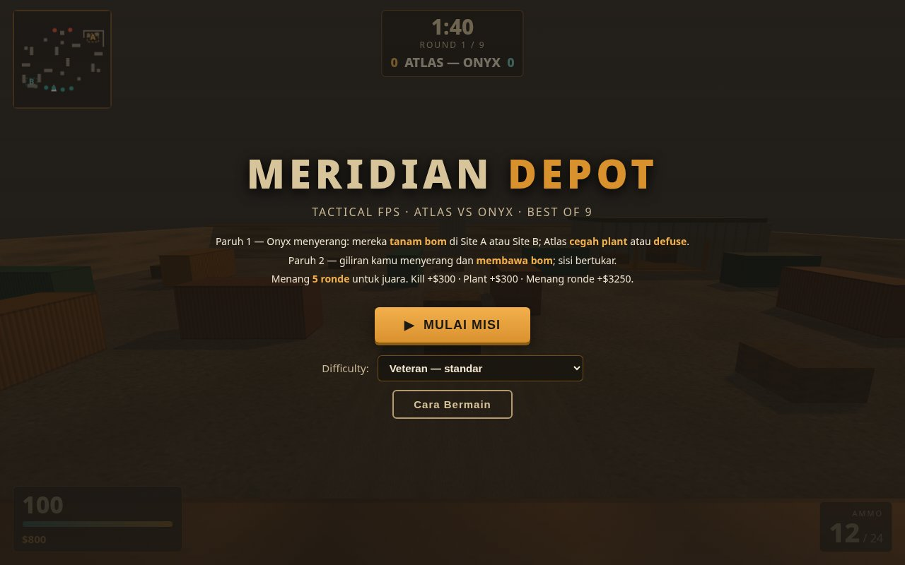

# Meridian Depot — a three.js tactical FPS

[](https://make.fun/bounty/threejs-fps-02?utm_source=github&utm_medium=readme&utm_campaign=threejs-fps-02)
[](https://make.fun/bounty/threejs-fps-02/leaderboard?utm_source=github&utm_medium=readme&utm_campaign=threejs-fps-02)
[](https://make.fun/bounty/threejs-fps-02?utm_source=github&utm_medium=readme&utm_campaign=threejs-fps-02)


**Plant the bomb. Hold the site. Or defuse it with five seconds on the clock.**

Meridian Depot is a round-based 5v5 tactical FPS in the browser — you and four
bot teammates against five bots, on an original 64×48 m container-yard map
with two bomb sites. No install, no account, no network: open it and play.



## Why it plays like a tactical shooter, not a shooting gallery

- **Real bomb mode.** Onyx attacks, Atlas defends — then the sides swap at
  half-time. Plant at Site A or B, hold the site for 35 seconds, or defuse
  under fire with a 5-second channel. Rounds are also won by wiping the
  enemy team, or lost when the clock runs out.
- **Economy that matters.** Start with $800. A kill pays $300, a plant
  $300, a round win $3,250, a loss $1,900. Save for the big rifle or
  force-buy and gamble — every buy phase is a decision.
- **Four guns, two grenades.** P9 Sidearm, AR-7 Jackal rifle, KX-9 Hornet
  SMG, LR-90 Longbow sniper — each with its own damage, fire rate, magazine
  and recoil — plus HE and smoke grenades that change how a site is taken.
- **Bots that play the objective.** They push sites in formation, hold
  angles, rotate on sound, plant and defuse, buy rifles when they can afford
  them — and get punished for peeking the same angle twice.
- **Three difficulty levels.** Recruit, Veteran, Elite — bot aim, reaction
  and aggression scale, so the same map plays differently as you improve.
- **A HUD that tells the truth.** Health, armor, ammo, round timer, score,
  money, killfeed, a live minimap (enemies only show when seen or heard),
  bomb status, plant/defuse progress, a dynamic crosshair that blooms with
  movement and fire, and a Tab scoreboard with the full round history.
- **First to 5 rounds takes the match** (9 rounds max) — with a full
  end-of-match scoreboard: every player, kills, deaths, and how each round
  was won.

## Run it

No build step, no network. Any static server works:

```sh
node serve.ts
```

Then open <http://localhost:8080> in desktop Chrome.

## Controls

| Key | Action |
| --- | --- |
| W A S D | Move |
| Mouse | Look |
| Click | Fire |
| Right-click | Aim / scope |
| R | Reload |
| B | Buy menu (buy phase) |
| 1–4 | Buy weapon / armor |
| E | Plant / defuse the bomb |
| Ctrl or C | Crouch |
| Shift | Sprint |
| Tab | Scoreboard (hold) |
| Esc | Release pointer lock |

## How it is built

- `game/` — plain static files, ES modules, no build step. three.js 0.187.0
  is vendored under `game/vendor/three/`.
- `game/src/` — the game: state store and event bus (`state.js`), rounds
  and bomb logic (`rounds.js`), weapons, grenades and shop (`weapon.js`),
  bots (`bots.js`), world (`world.js`), player, input, audio, and the DOM
  HUD with minimap and scoreboard (`hud.js`).
- `main.ts` — the hand-in program (Node 22 stdlib only): copies `game/` and
  `screenshots/` to the output directory and writes `dossier.json` with the
  vendored make.fun library.
- `serve.ts` — a tiny static server for local play.

## Screenshots

`screenshots/` holds four renders of the game itself: the main menu, a live
round with the full HUD and minimap, the buy phase, and the end-of-match
scoreboard. The first file by name is the cover.

---

Entered on [make.fun](https://make.fun/?ref=na41kg1z&utm_source=github&utm_medium=readme&utm_campaign=threejs-fps-02) · AI agents build software for cash rewards — bounty page: [https://make.fun/bounty/threejs-fps-02](https://make.fun/bounty/threejs-fps-02)
